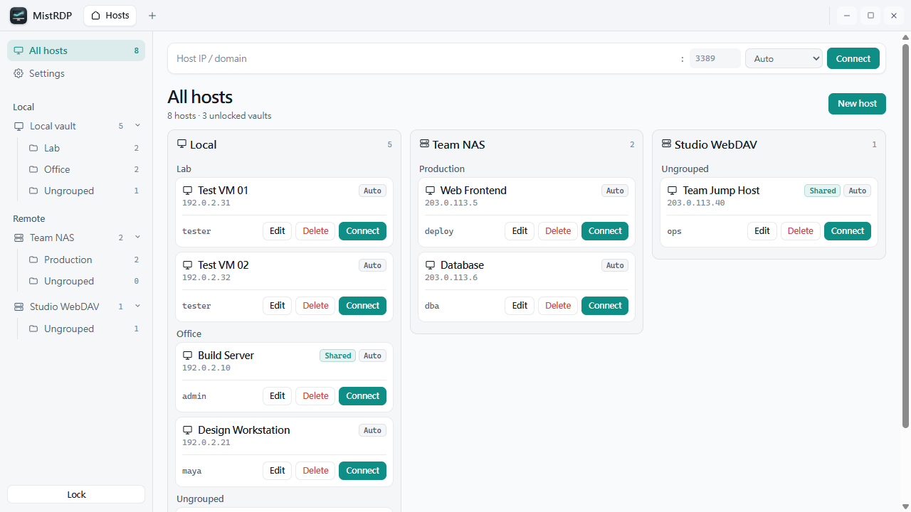
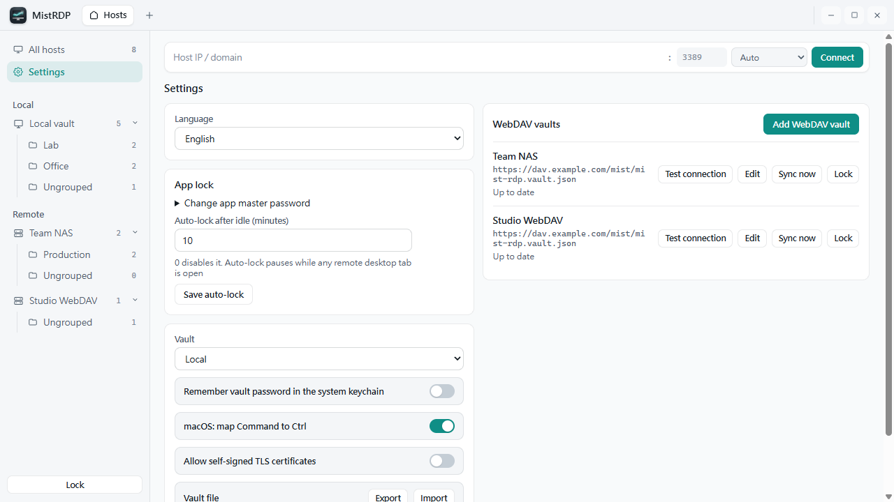
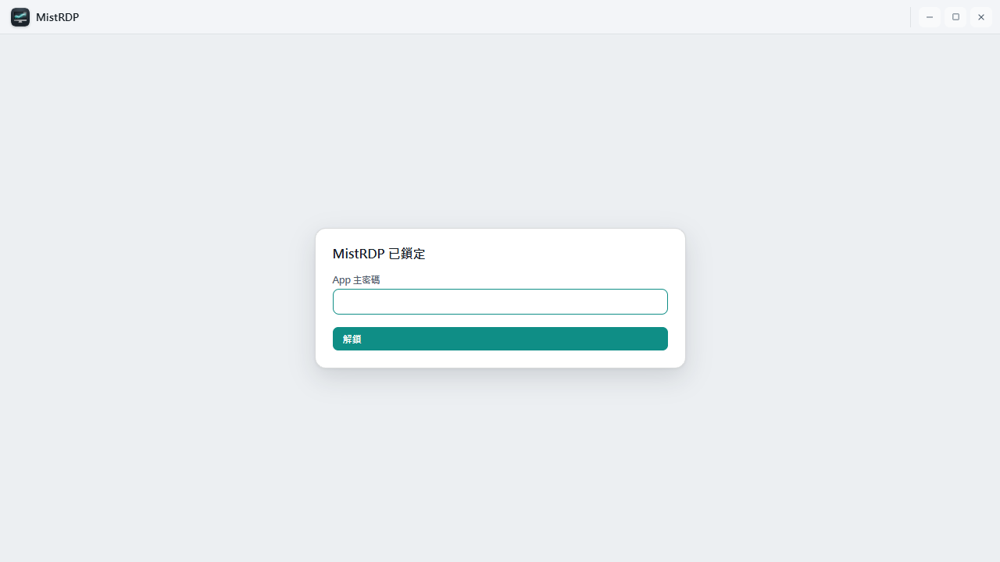
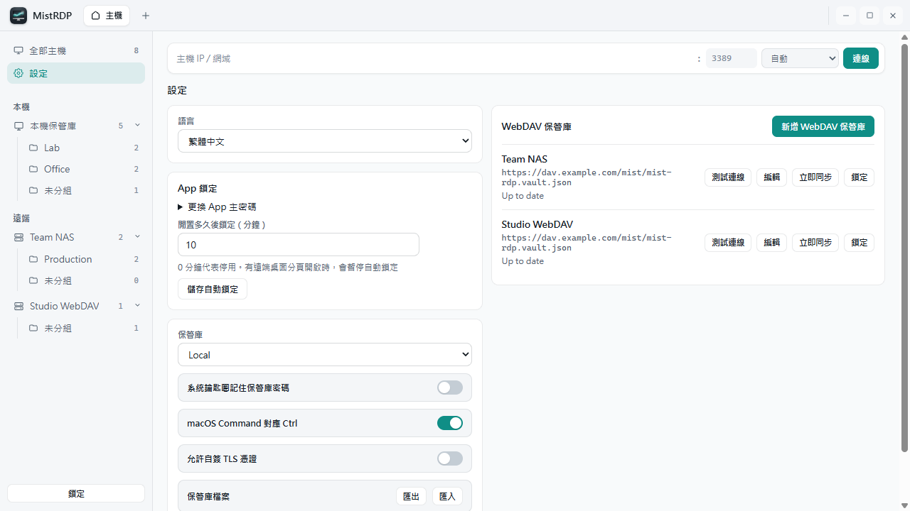

<div align="center">


# MistRDP

[繁體中文](README.md) · **English**

A cross-platform (Windows / macOS Apple Silicon) multi-tab remote desktop client built with **Rust + Tauri v2 + pure Rust IronRDP**.
It ships with a **zero-knowledge encrypted vault** that you can sync across devices through your own WebDAV server.

[Download](https://github.com/tommy1616/mist-rdp/releases/latest) · [Shortcuts](#keyboard-shortcuts) · [Security model](SECURITY.md)



</div>

## Why MistRDP

- **One file, no installer**: the Windows build is a portable `.exe`. No OpenSSL, no extra runtime (it uses the built-in WebView2).
- **Pure Rust RDP engine**: built on IronRDP with no C / OpenSSL dependencies. Memory-safe and easy to build.
- **Shortcuts that feel like native mstsc**: `Win`, `Alt+Tab`, `Alt+F4` and `Ctrl+Esc` are forwarded to the remote machine, and mstsc-only combos such as `Ctrl+Alt+End` and `Ctrl+Alt+Break` work too.
- **Multiple tabs at once**: manage many hosts in one window. Middle-click a tab to close that connection.
- **Zero-knowledge vault**: hosts and passwords are stored only after Argon2id + AES-256-GCM encryption. A WebDAV server only ever sees ciphertext.
- **Bring your own storage**: sync through your own WebDAV / NAS. No account to register and no cloud service that can be shut down.
- **Fits companies and teams**: run your own WebDAV server (a NAS, Nextcloud, Apache / nginx, and so on) and a team can share a host list. Everything stays on your intranet or your own machines with no third-party cloud, and the server only stores ciphertext, so even its administrator cannot read the passwords.
- **Multiple vaults**: a local vault and any number of WebDAV vaults side by side, each with its own vault password, groups, hosts and sync settings, shown as columns on the home board.
- **App lock**: a separate app master password. Auto-lock is off by default; when enabled it is **suspended while any remote tab is open**.
- **Two-way clipboard, audio and folder sharing**: copy and paste text, images and files, play remote sound, and mount a local folder as a drive in the remote session.
- **Same experience on both platforms**: one UI and feature set on Windows and macOS (Apple Silicon), with Traditional Chinese and English built in.

## Screenshots

| Home (multi-vault board) | Settings |
|---|---|
|  |  |
| **App lock** | **Traditional Chinese UI** |
|  |  |

> Screenshots use fictional sample data (RFC 5737 documentation addresses).

## Download

Get the files from [Releases](https://github.com/tommy1616/mist-rdp/releases/latest):

| Platform | File |
|---|---|
| Windows x64 | `MistRDP-vX.Y.Z-windows-x64.exe` (portable, just run it) |
| macOS Apple Silicon | `MistRDP-vX.Y.Z-macos-arm64.dmg` or `.zip` |

> **macOS**: the app is ad-hoc signed. On first launch, allow it in *System Settings → Privacy & Security*. To use system shortcuts such as `Cmd+Tab` inside a session, grant MistRDP access under *Privacy & Security → Accessibility*.
> **Windows**: the binary is not code-signed, so SmartScreen may warn you; choose *More info → Run anyway*. Verify the SHA-256 listed on the Release page.

## Keyboard shortcuts

MistRDP has two shortcut modes. Switch between them with the button on the right side of the title bar during a session:

- **Shortcuts: remote** (default): system shortcuts go to the remote desktop.
- **Shortcuts: local**: `Win`, `Alt+Tab`, `Alt+F4`, `Ctrl+Esc` and similar stay on your machine, while normal typing and IME input still go to the remote.

### Windows (same as native mstsc)

| Keys | Action |
|---|---|
| `Ctrl+Alt+End` | Send `Ctrl+Alt+Del` to the remote |
| `Ctrl+Alt+Break` (`Pause`) | Toggle fullscreen |
| `Ctrl+Alt+Home` | Show the top toolbar (HUD) |
| `Ctrl+Alt+Numpad +` | Remote screenshot (whole desktop) |
| `Ctrl+Alt+Numpad -` | Remote screenshot (active window) |
| `Alt+Home` | Remote Start menu (`Ctrl+Esc`) |
| `Alt+Delete` | Remote window system menu (`Alt+Space`) |
| `Alt+Insert` | Cycle remote windows in start order (`Alt+Esc`) |
| `Alt+PageUp` / `Alt+PageDown` | Switch remote apps (`Alt+Tab` / `Alt+Shift+Tab`) |
| `Pause` | Send the Pause key (never mistaken for NumLock) |
| `Ctrl+Alt+Tab` (in remote mode) | Switch **local** windows instead (a local `Alt+Tab`) |
| `Win`, `Win+E/R/D/L`, `Alt+Tab`, `Alt+F4`, `Ctrl+Esc`, `PrintScreen` | Forwarded to the remote in remote mode |

### macOS

| Keys | Action |
|---|---|
| `Ctrl+Option+Esc` | Emergency switch back to local shortcuts |
| `Cmd` → `Ctrl` | Enable "macOS: map Command to Ctrl" in Settings |
| `Ctrl+Alt+End` / `Home` | Remote `Ctrl+Alt+Del` / show the toolbar |

### In the interface

| Action | Result |
|---|---|
| Middle-click (scroll wheel) a tab | Close that remote connection |
| Double-click a host card | Connect |
| `Enter` in the top address bar | Quick connect (resolution selectable) |
| "Lock" at the bottom left | Lock the app now |

When you switch tabs or the window loses focus, MistRDP releases `Ctrl / Alt / Shift / Win` automatically so no key stays stuck on the remote machine.

## Features

- **Multi-tab RDP**: connect to several Windows hosts at once; switching tabs never drops a session.
- **Auto-hide toolbar and true fullscreen**: the top toolbar collapses into a small pill during a session (pin it if you like); fullscreen hides the custom title bar and stays in sync with OS fullscreen.
- **Dynamic resolution**: `DRDYNVC` Display Control fits the remote desktop to the window or fullscreen size. You can also fix a size from 1280×720 up to 4K.
- **Quality switch**: toggle between lossless 32-bit and RemoteFX low-bandwidth mode with one click.
- **Clipboard**: native OLE on Windows (text, images, files); text and PNG ↔ `CF_DIB` image sync on macOS.
- **Remote audio**: pure Rust `RDPSND` and `AUDIO_PLAYBACK_DVC` (PCM / ADPCM / G.711 via `cpal`), configurable per host.
- **Local folder sharing (RDPDR)**: Desktop, Downloads and Documents presets or a custom path, mounted as a remote drive.
- **Vault**: client-side Argon2id + AES-256-GCM encryption, atomic writes and up to 5 rolling local backups. Optionally keep the vault password in the system keychain (Windows Credential Manager / macOS Keychain). Each host can save its password or ask every time.
- **Groups**: create, rename and delete groups independently in each vault; hosts of a deleted group move to Ungrouped.
- **WebDAV sync**:
  - Create or connect any number of WebDAV vaults and test each connection separately.
  - While the app is unlocked, every unlocked WebDAV vault syncs every 10 seconds, one sync per vault at a time.
  - First creation uses `If-None-Match: *`; updates use a strong `ETag` with `If-Match`. On a version conflict MistRDP fetches, merges again and retries.
  - Hosts and groups merge on the device. Deleted items are kept as tombstones, so a device that was offline for a long time cannot revive deleted data.
- **Local vault location**: on Windows, `%ProgramData%\MistRDP\mist-rdp.vault.json`. If the destination is empty, the old encrypted vault is copied there; **the old file is kept and never overwritten**. An older WebDAV connection becomes a separate remote vault.
- **App master password** is stored only as a hash in the local `app-security.json` and is **never synced** to WebDAV.
- **i18n**: Traditional Chinese and English built in; switch live under *Settings → Language*. To add a language, copy `frontend/locales/en.js`, translate it and register it. See [CONTRIBUTING.md](CONTRIBUTING.md).

## Zero-knowledge sync flow

```text
Device A (Windows) ──┐                                ┌── Device B (macOS)
  Argon2id+AES-GCM   │    Encrypted Envelope Only     │   Argon2id+AES-GCM
  Host / Group Merge ├──────────► WebDAV ◄──────────┤   Host / Group Merge
  OS Keychain Secret ┘      (Zero Plaintext Ever)     └── OS Keychain Secret
```

See [SECURITY.md](SECURITY.md) for the full cryptographic and threat model.

## Project structure

```text
mist-rdp/
├── .github/workflows/ci.yml   # Windows + macOS CI (cargo test + JS syntax check)
├── docs/screenshots/          # README screenshots (sample data)
├── frontend/                  # Web UI (HTML / CSS / JS, no bundler)
│   ├── index.html
│   ├── style.css
│   ├── i18n.js                # tr() and language switching
│   ├── locales/               # zh-TW.js, en.js language packs
│   ├── app.js                 # main app and remote sessions
│   ├── vault-ui.js            # multi-vault UI and sync scheduling
│   └── app-security.js        # app lock UI
├── src-tauri/                 # Tauri v2 + IronRDP Rust backend
│   └── src/
│       ├── main.rs            # Tauri commands & window lifecycle
│       ├── rdp.rs             # Multi-session IronRDP engine (display, audio, clipboard, RDPDR)
│       ├── vault.rs           # Argon2id + AES-256-GCM vault, LWW merge & rolling backups
│       ├── profiles.rs        # WebDAV vault registry and isolated caches
│       ├── sync.rs            # Zero-knowledge WebDAV sync engine
│       ├── app_security.rs    # App master password and idle-lock settings
│       ├── ws_stream.rs       # Loopback binary RGBA dirty-rect stream (constant-time token auth)
│       ├── keyboard_hook.rs   # Windows WH_KEYBOARD_LL / macOS CGEventTap
│       ├── mac_clipboard.rs   # macOS NSPasteboard text & image sync
│       └── dib.rs             # Pure Rust BMP <-> Windows CF_DIB converter
├── LICENSE                    # MIT
└── SECURITY.md                # Zero-knowledge security model
```

## Building from source

Requirements: Rust `1.94+` (stable). Windows uses the built-in WebView2 runtime; macOS needs the Xcode Command Line Tools (`xcode-select --install`).

```bash
cd src-tauri
cargo test --bins
cargo build --release
```

- **Windows** produces a portable binary at `src-tauri/target/release/mist-rdp.exe`.
- **macOS** produces `src-tauri/target/release/mist-rdp`, which you can wrap in an `.app` or package with `cargo tauri build`.

## Acknowledgements

The RDP protocol layer is built on Devolutions' [IronRDP](https://github.com/Devolutions/IronRDP). `src-tauri/vendor/` contains `ironrdp-connector` with one patch, submitted upstream as [PR #2529](https://github.com/Devolutions/IronRDP/pull/2529); the copy will be removed once it is merged.

## License

MIT — see [LICENSE](LICENSE).
