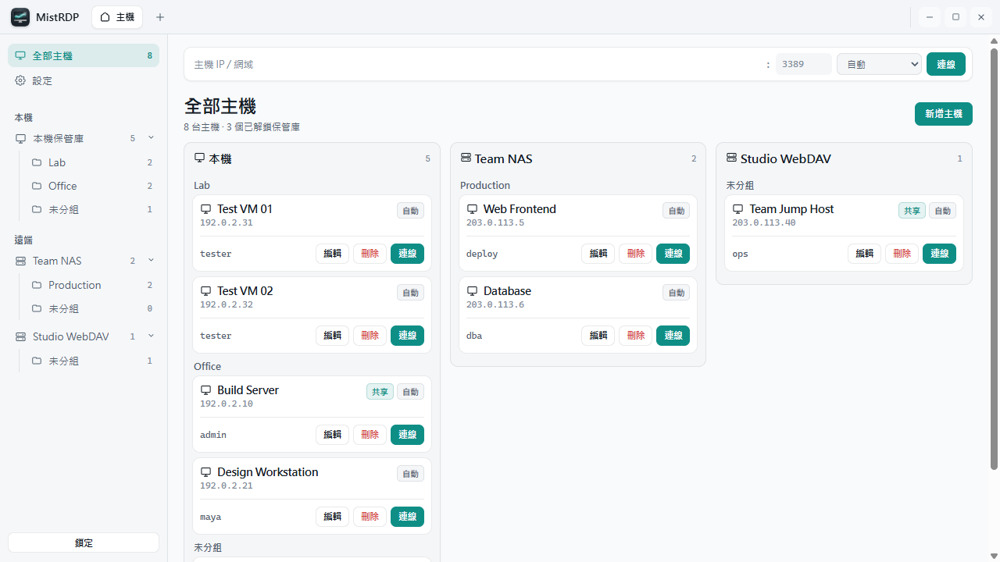
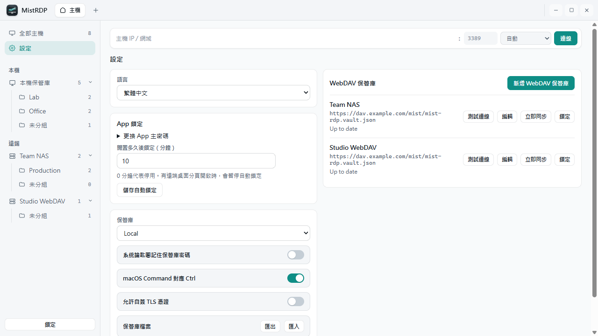
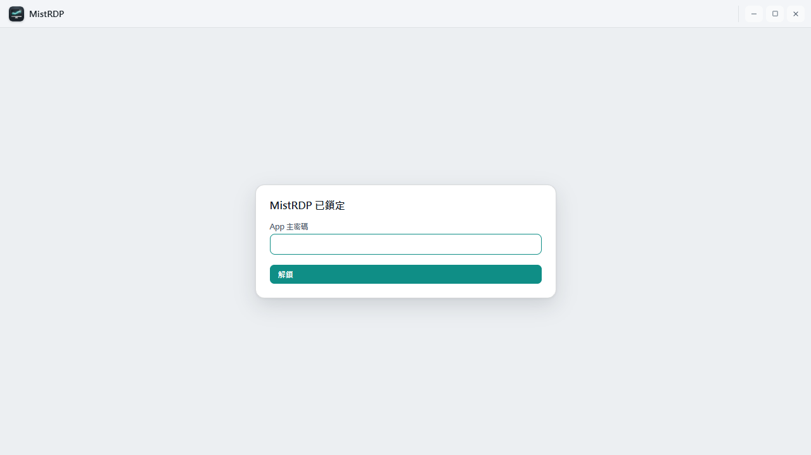
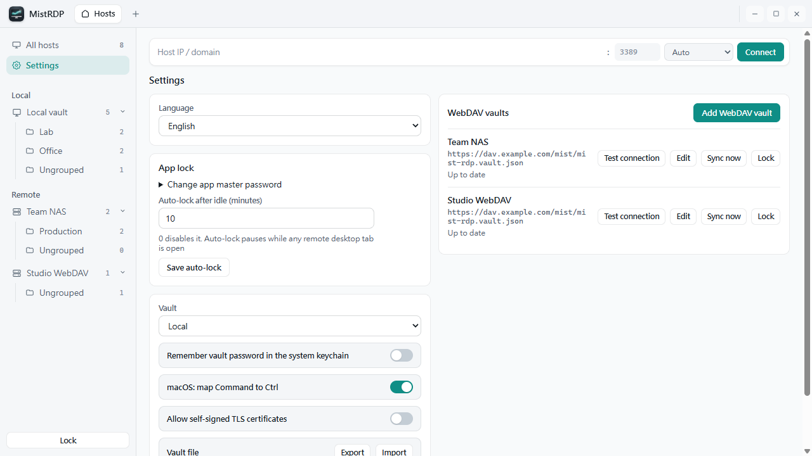

<div align="center">


# MistRDP

**繁體中文** · [English](README.en.md)

跨平台（Windows／macOS Apple Silicon）多分頁遠端桌面用戶端，使用 **Rust + Tauri v2 + 純 Rust IronRDP** 打造。
內建**零知識加密保管庫**，並可透過自己的 WebDAV 在多台裝置之間同步。

[下載](https://github.com/tommy1616/mist-rdp/releases/latest) · [快捷鍵](#快捷鍵) · [安全模型](SECURITY.md)



</div>

## 為什麼選 MistRDP

- **單一檔案、免安裝**：Windows 為可攜式 `.exe`，不需要 OpenSSL、不需要額外執行環境（使用系統內建的 WebView2）。
- **純 Rust 的 RDP 引擎**：以 IronRDP 實作，沒有 C／OpenSSL 依賴，記憶體安全，建置單純。
- **和原生 mstsc 一樣順手的快捷鍵**：`Win`、`Alt+Tab`、`Alt+F4`、`Ctrl+Esc` 都能轉送到遠端，連 `Ctrl+Alt+End`、`Ctrl+Alt+Break` 等 mstsc 專屬組合鍵都支援。
- **多分頁同時連線**：一個視窗管理多台主機，分頁可用滑鼠中鍵直接關閉。
- **保管庫零知識**：主機與密碼只以 Argon2id + AES-256-GCM 加密後存放，WebDAV 伺服器永遠只看到密文。
- **自己的資料自己管（BYOS）**：用你自己的 WebDAV／NAS 同步，不需要註冊帳號，也沒有雲端服務可以被關閉。
- **多保管庫**：本機與多個 WebDAV 保管庫並存，各自擁有獨立的保管庫密碼、群組、主機與同步設定，首頁用看板分欄呈現。
- **App 鎖定**：另設 App 主密碼；預設不鎖定，可設定閒置自動鎖定，**有任何遠端分頁開著就不會鎖**。
- **雙向剪貼簿、音訊、資料夾共享**：文字、圖片與檔案複製貼上，遠端聲音播放，本機資料夾以磁碟機掛進遠端。
- **雙平台一致體驗**：Windows 與 macOS（Apple Silicon）共用同一套介面與功能，並內建繁體中文與英文。

## 截圖

| 首頁（多保管庫看板） | 設定 |
|---|---|
|  |  |
| **App 鎖定** | **English UI** |
|  |  |

> 截圖使用虛構的範例資料（RFC 5737 文件專用位址）製作。

## 下載

到 [Releases](https://github.com/tommy1616/mist-rdp/releases/latest) 下載：

| 平台 | 檔案 |
|---|---|
| Windows x64 | `MistRDP-vX.Y.Z-windows-x64.exe`（可攜式，直接執行） |
| macOS Apple Silicon | `MistRDP-vX.Y.Z-macos-arm64.dmg` 或 `.zip` |

> **macOS**：App 目前為臨時簽署（ad-hoc），第一次開啟請在「系統設定 → 隱私權與安全性」允許。若要在遠端內使用 `Cmd+Tab` 等系統快捷鍵，請在「隱私權與安全性 → 輔助使用」授權 MistRDP。
> **Windows**：未購買程式碼簽章憑證，SmartScreen 可能顯示提醒，請選「其他資訊 → 仍要執行」。建議核對 Release 頁面列出的 SHA-256。

## 快捷鍵

MistRDP 有兩種快捷鍵模式，可在遠端連線中按標題列右側的按鈕切換：

- **快捷鍵：遠端**（預設）：系統快捷鍵送到遠端桌面。
- **快捷鍵：本機**：`Win`、`Alt+Tab`、`Alt+F4`、`Ctrl+Esc` 等留在本機，一般輸入與輸入法仍送到遠端。

### Windows（與原生 mstsc 相同）

| 按鍵 | 功能 |
|---|---|
| `Ctrl+Alt+End` | 送出 `Ctrl+Alt+Del` 到遠端 |
| `Ctrl+Alt+Break`（`Pause`） | 切換全螢幕 |
| `Ctrl+Alt+Home` | 顯示頂部工具列（HUD） |
| `Ctrl+Alt+數字鍵 +` | 遠端畫面截圖（整個桌面） |
| `Ctrl+Alt+數字鍵 -` | 遠端畫面截圖（目前視窗） |
| `Alt+Home` | 遠端開始功能表（`Ctrl+Esc`） |
| `Alt+Delete` | 遠端視窗系統功能表（`Alt+Space`） |
| `Alt+Insert` | 依開啟順序切換遠端視窗（`Alt+Esc`） |
| `Alt+PageUp` / `Alt+PageDown` | 切換遠端程式（`Alt+Tab` / `Alt+Shift+Tab`） |
| `Pause` | 送出 Pause 鍵（不會被誤判為 NumLock） |
| `Ctrl+Alt+Tab`（遠端模式下） | 改為切換**本機**視窗（相當於本機 `Alt+Tab`） |
| `Win`、`Win+E/R/D/L`、`Alt+Tab`、`Alt+F4`、`Ctrl+Esc`、`PrintScreen` | 遠端模式下轉送到遠端 |

### macOS

| 按鍵 | 功能 |
|---|---|
| `Ctrl+Option+Esc` | 緊急切回「本機快捷鍵」 |
| `Cmd` → `Ctrl` | 可在設定開啟「macOS Command 對應 Ctrl」 |
| `Ctrl+Alt+End`／`Home` | 遠端 `Ctrl+Alt+Del`／顯示工具列 |

### 介面操作

| 操作 | 功能 |
|---|---|
| 滑鼠中鍵（滾輪）點分頁 | 關閉該遠端連線 |
| 雙擊主機卡片 | 連線 |
| 頂部輸入列 `Enter` | 快速連線（可選解析度） |
| 左下角「鎖定」 | 立即鎖定 App |

切換分頁或視窗失焦時，MistRDP 會自動放開 `Ctrl／Alt／Shift／Win`，避免按鍵卡在遠端。

## 功能總覽

- **多分頁 RDP**：同時連多台 Windows 主機，切換分頁不會中斷連線。
- **自動隱藏工具列與真全螢幕**：連線中頂端工具列收成小膠囊（可釘選）；全螢幕隱藏自訂標題列，並與系統全螢幕保持同步。
- **動態解析度**：以 `DRDYNVC` Display Control 讓遠端畫面隨視窗或全螢幕大小自動調整；也可固定 1280×720 到 4K。
- **畫質切換**：無損 32-bit 與 RemoteFX 省頻寬模式一鍵切換。
- **剪貼簿**：Windows 原生 OLE（文字、圖片、檔案）；macOS 文字與 PNG ↔ `CF_DIB` 圖片雙向同步。
- **遠端聲音**：純 Rust 實作 `RDPSND` 與 `AUDIO_PLAYBACK_DVC`（PCM／ADPCM／G.711，使用 `cpal`），可依主機設定。
- **本機資料夾共享（RDPDR）**：桌面、下載、文件快速選項，或自訂路徑，掛成遠端磁碟機。
- **保管庫**：Argon2id + AES-256-GCM 用戶端加密、原子寫入、最多 5 份本機滾動備份；可選擇把保管庫密碼存入系統鑰匙圈（Windows 認證管理員／macOS 鑰匙圈）；每台主機可選擇儲存密碼或每次詢問。
- **群組**：每個保管庫各自建立、改名、刪除群組；刪除後的主機移到「未分組」。
- **WebDAV 同步**：
  - 可建立或連線多個 WebDAV 保管庫，並可個別測試連線。
  - App 解鎖期間，已解鎖的 WebDAV 保管庫每 10 秒同步一次，每個保管庫同一時間只跑一個同步。
  - 首次建立使用 `If-None-Match: *`，更新使用強 `ETag` 搭配 `If-Match`，版本衝突時會重新取得並合併後重試。
  - 主機與群組在裝置上合併；刪除的項目以墓碑保留，離線很久的裝置回來也不會讓已刪除的資料復活。
- **本機保管庫位置**：Windows 為 `%ProgramData%\MistRDP\mist-rdp.vault.json`。若目標為空，會自動複製舊的加密保管庫，**舊檔保留、不會覆蓋**；舊版 WebDAV 連線會變成獨立的遠端保管庫。
- **App 主密碼**只以雜湊存在本機的 `app-security.json`，**不會同步**到 WebDAV。
- **多語言（i18n）**：內建繁體中文與 English，在「設定 → 語言」即時切換；新增語言只需複製 `frontend/locales/en.js` 翻譯後註冊即可，詳見[貢獻指南](CONTRIBUTING.md)。

## 零知識同步流程

```text
裝置 A (Windows) ──┐                               ┌── 裝置 B (macOS)
  Argon2id+AES-GCM │      只有加密信封              │   Argon2id+AES-GCM
  主機／群組合併   ├────────► WebDAV ◄────────────┤   主機／群組合併
  系統鑰匙圈密鑰   ┘     （伺服器永遠看不到明文）    └── 系統鑰匙圈密鑰
```

完整的密碼學與威脅模型請見 [SECURITY.md](SECURITY.md)（英文）。

## 專案結構

```text
mist-rdp/
├── .github/workflows/ci.yml   # Windows + macOS CI（cargo test + JS 語法檢查）
├── docs/screenshots/          # README 截圖（範例資料）
├── frontend/                  # Web UI（HTML / CSS / JS，無打包工具）
│   ├── index.html
│   ├── style.css
│   ├── i18n.js                # tr() 與語言切換
│   ├── locales/               # zh-TW.js、en.js 語言包
│   ├── app.js                 # 主程式與遠端工作階段
│   ├── vault-ui.js            # 多保管庫介面與同步排程
│   └── app-security.js        # App 鎖定介面
├── src-tauri/                 # Tauri v2 + IronRDP Rust 後端
│   └── src/
│       ├── main.rs            # Tauri 命令與視窗生命週期
│       ├── rdp.rs             # 多工作階段 IronRDP 引擎（畫面、音訊、剪貼簿、RDPDR）
│       ├── vault.rs           # Argon2id + AES-256-GCM 保管庫、LWW 合併、滾動備份
│       ├── profiles.rs        # WebDAV 保管庫登錄與各自快取
│       ├── sync.rs            # 零知識 WebDAV 同步引擎
│       ├── app_security.rs    # App 主密碼與閒置鎖定設定
│       ├── ws_stream.rs       # 本機迴路 RGBA 髒矩形串流（常數時間 token 驗證）
│       ├── keyboard_hook.rs   # Windows WH_KEYBOARD_LL／macOS CGEventTap
│       ├── mac_clipboard.rs   # macOS NSPasteboard 文字與圖片同步
│       └── dib.rs             # 純 Rust BMP ↔ Windows CF_DIB 轉換
├── LICENSE                    # MIT
└── SECURITY.md                # 零知識安全模型
```

## 從原始碼建置

需求：Rust `1.94+`（stable）。Windows 使用系統內建的 WebView2；macOS 需要 Xcode Command Line Tools（`xcode-select --install`）。

```bash
cd src-tauri
cargo test --bins
cargo build --release
```

- **Windows** 產生可攜式執行檔 `src-tauri/target/release/mist-rdp.exe`。
- **macOS** 產生 `src-tauri/target/release/mist-rdp`，可包成 `.app`，或使用 `cargo tauri build` 打包。

## 致謝

RDP 協定實作建立在 Devolutions 的 [IronRDP](https://github.com/Devolutions/IronRDP) 之上（`src-tauri/vendor/` 內為含一項修補的 `ironrdp-connector`，修補已以 [PR #2529](https://github.com/Devolutions/IronRDP/pull/2529) 提交上游，合併後就會移除）。

## 授權

MIT，詳見 [LICENSE](LICENSE)。
